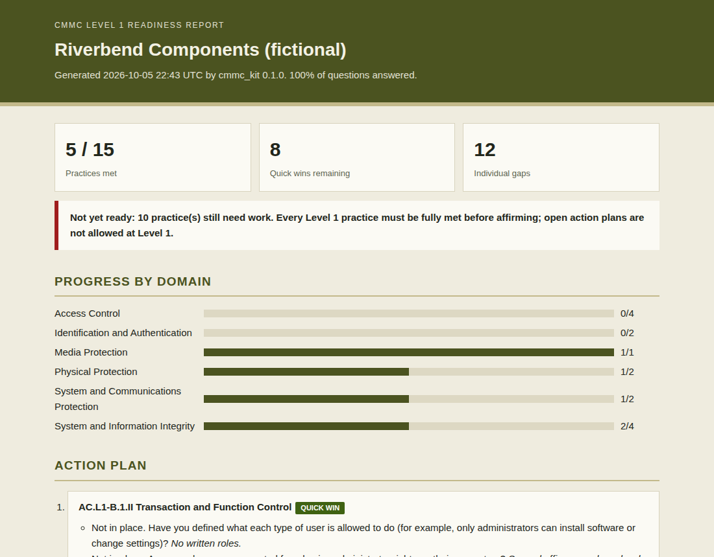

# CMMC Readiness Toolkit

[](https://github.com/Edward-Owusu/cmmc-readiness-toolkit/actions/workflows/tests.yml)
[](LICENSE)

An open-source, guided self-assessment that helps **small defense suppliers** prepare for **CMMC Level 1**. A business owner or office manager answers 30 plain-language questions covering all 15 Level 1 requirements, and the toolkit produces a readiness result, a prioritized action plan with quick wins first, and a **draft System Security Plan** ready to review and complete.



## Why this matters

The Department of Defense depends on a large base of small manufacturers, machine shops, and service providers. Many of them handle Federal Contract Information (FCI), such as purchase orders, drawings, and delivery schedules, and are now subject to the Cybersecurity Maturity Model Certification (CMMC) program. The CMMC program rule (32 CFR Part 170) took effect in December 2024, and CMMC requirements began phasing into DoD contracts in 2025.

Level 1 is the entry point: 15 basic safeguarding requirements, assessed by the company itself every year and affirmed by a senior official in the Supplier Performance Risk System (SPRS). Every requirement must be fully met, with no open action plans allowed. Large primes have compliance teams for this. A 20-person machine shop usually has an office manager and an outside IT provider, and the official language of the requirements can be hard to translate into everyday tasks.

This toolkit closes that gap. It turns each requirement into questions a non-specialist can answer, tells the company exactly what is missing and how to fix it, and drafts the documentation they will need. Helping small suppliers meet CMMC keeps them eligible for defense work and strengthens the security of the defense supply chain as a whole.

## What it does

- **Guided questionnaire:** a step-by-step walkthrough of all **15 CMMC Level 1 practices** across six domains, using **30 plain-language questions**, each with the evidence to keep.
- **Accurate status rules:** a practice is met only when every question is satisfied; "partly" counts as not met; N/A requires a written justification.
- **Readiness verdict:** shows whether the company is ready for the annual self-assessment and affirmation, reflecting that Level 1 does not allow open action plans.
- **Action plan:** unmet practices with the specific failing items and fixes, ordered with **quick wins first**.
- **Draft System Security Plan:** system identification, boundary, FCI types, and an implementation section for every practice, built from the answers.
- **Traceability:** each practice is mapped to its FAR 52.204-21 clause and the corresponding NIST SP 800-171 requirements, so the work carries forward to Level 2.
- **Save and resume:** answers download as a JSON file that can be loaded again later.
- Readiness reports in **HTML, Markdown, CSV, and JSON**; System Security Plan in **HTML and Markdown**; command-line tool and **Streamlit dashboard**.

## Quick start

Requires Python 3.10 or later.

```bash
git clone https://github.com/Edward-Owusu/cmmc-readiness-toolkit.git
cd cmmc-readiness-toolkit
pip install -e .

cmmc-check samples/riverbend_components_level1.json --format html md --ssp
```

Example output:

```
Riverbend Components (fictional) | CMMC Level 1 | 100% answered
Practices met: 5 of 15 | Ready to affirm: Not yet
  Access Control                         0/4
  Identification and Authentication      0/2
  Media Protection                       1/1
  Physical Protection                    1/2
  System and Communications Protection   1/2
  System and Information Integrity       2/4
Quick wins to start with: AC.L1-B.1.II, AC.L1-B.1.I, AC.L1-B.1.IV, IA.L1-B.1.V, IA.L1-B.1.VI
```

Reports are written to the `reports` folder. Pre-generated reports and System Security Plans are in [docs/example-reports](docs/example-reports).

### Guided questionnaire

```bash
pip install -r requirements.txt
streamlit run app/streamlit_app.py
```

Work through the steps (company profile, six domains, results), then download your readiness report, draft System Security Plan, and answers file.

## Related projects

This is the fifth tool in a series of open-source GRC tools for small and mid-sized organizations:

- [NIST SP 800-53 Assessment Tool](https://github.com/Edward-Owusu/Nist-800-53-assessment-tool)
- [Zero Trust IAM Auditor](https://github.com/Edward-Owusu/Zero-trust-iam-auditor)
- [MFA Compliance Tracker](https://github.com/Edward-Owusu/mfa-compliance-tracker)
- [FedRAMP Cloud Analyzer](https://github.com/Edward-Owusu/fedramp-cloud-analyzer)
- CMMC Readiness Toolkit (this project)

## Roadmap

- **CMMC Level 2:** the 110 NIST SP 800-171 requirements, with scoring under the DoD Assessment Methodology and plan of action tracking.
- Word export of the System Security Plan.
- Evidence checklist export for the annual self-assessment.

## Data and limitations

All sample data is synthetic and does not describe any real organization or person. The questions are plain-language aids written for this tool, not the official assessment objectives. This toolkit is a self-assessment aid, **not a CMMC assessment, certification, or legal advice**. Confirm current requirements in 32 CFR Part 170, your contract, and official DoD CMMC guidance. See the [methodology](docs/methodology.md) and [answers reference](docs/answers-reference.md).

## References

- 32 CFR Part 170, Cybersecurity Maturity Model Certification (CMMC) Program
- FAR 52.204-21, Basic Safeguarding of Covered Contractor Information Systems
- DoD CMMC program information: https://dodcio.defense.gov/CMMC/
- NIST SP 800-171 Rev. 2, *Protecting Controlled Unclassified Information in Nonfederal Systems and Organizations*

## Author

**Edward Owusu, CISA**, GRC Analyst and IT Auditor.

Feedback, issues, and contributions are welcome. If your company uses this toolkit to prepare for CMMC, I would be glad to hear how it worked for you; please open an issue or get in touch.

## Citation

If you use this tool in research or professional work, please cite it using the metadata in [CITATION.cff](CITATION.cff).

## License

[MIT](LICENSE)
